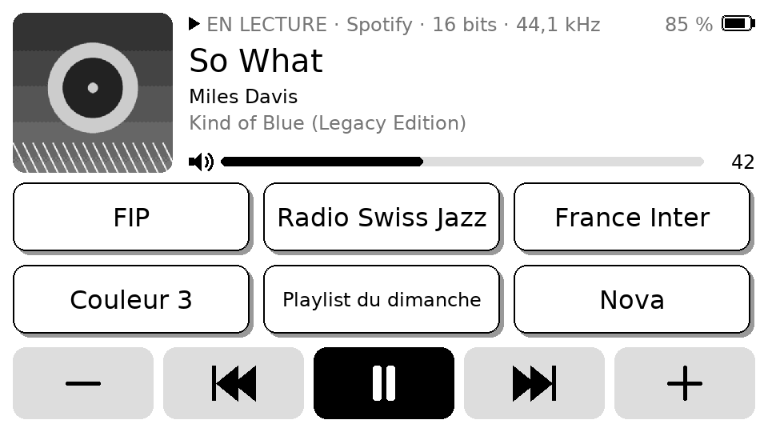

# Télécommande WiiM pour M5PaperS3

Firmware pour le M5PaperS3 (écran e-ink tactile 4,7", 960×540) qui pilote un streamer WiiM sur le réseau local : presets favoris, lecture/pause, piste précédente/suivante, volume, et un bandeau « en cours de lecture » avec la pochette de l'album.



- **Pochette** en 16 niveaux de gris, téléchargée en arrière-plan (l'écran reste réactif), avec titre, artiste, album, source (Spotify, AirPlay…), qualité audio (« 16 bits · 44,1 kHz »), barre de volume et niveau de batterie

- **Aucune appli à installer** : tout se règle depuis un téléphone, via un portail Wi-Fi affiché à l'écran (avec QR code)
- **API locale du WiiM** (`httpapi.asp`), aucun cloud
- **TLS épinglé** : le certificat auto-signé du WiiM est enregistré à la première connexion, puis comparé (SHA-256) avant chaque requête
- **Accents** : police lissée DejaVu Sans générée pour l'e-ink (latin étendu : é, ü, ç, Œ, €…)
- **Réglages conservés** lors des mises à jour du firmware (mémoire NVS)

## 1. Obtenir le firmware

Pousse ce dossier dans un dépôt GitHub (privé ou public). La compilation se lance toute seule :
onglet **Actions** > dernière exécution > artefact **wiim-remote-papers3**. Tu y trouves `wiim-remote-papers3.bin`.

## 2. Flasher depuis Windows, sans rien installer

1. Ouvre **Chrome ou Edge** (Firefox ne gère pas le port série web) sur https://espressif.github.io/esptool-js/
2. Branche le M5PaperS3 en USB-C puis passe-le en **mode téléchargement** : appui long sur le bouton d'alimentation jusqu'à ce que la LED arrière **clignote en rouge**.
3. Clique **Connect**, choisis le port qui apparaît (« USB JTAG/serial debug unit »).
4. Dans *Flash Address* mets **0x0**, choisis `wiim-remote-papers3.bin`, clique **Program**.
5. À la fin, appuie brièvement sur le bouton d'alimentation pour redémarrer.

## 3. Configurer avec ton téléphone

Au premier démarrage, l'écran affiche « Configuration » avec un QR code.

1. Scanne le QR code (ou rejoins le Wi-Fi `WiiM-Remote-XXXX` avec le mot de passe affiché).
2. La page de configuration s'ouvre ; sinon va sur **http://192.168.4.1**.
3. Renseigne :
   - ton **Wi-Fi** (2,4 GHz : l'ESP32 ne voit pas le 5 GHz)
   - l'**IP du WiiM** : app WiiM Home > ton appareil > Paramètres > Informations (pense à la réserver dans ta box)
   - tes **presets**, une ligne par bouton : `numéro=nom` (numéro du preset dans l'app WiiM Home, 12 boutons max)
   ```
   1=Radio Swiss Jazz
   2=Couleur 3
   3=Playlist du dimanche
   ```
4. **Enregistrer** : la télécommande redémarre, se connecte et affiche l'interface. Le premier appui enregistre le certificat du WiiM (« Certificat du WiiM enregistré »).

**Reconfigurer plus tard** : appui long (3 s) sur le bandeau du haut (titre en cours).

## Utilisation

| Zone | Action |
|---|---|
| Bandeau du haut | Pochette, titre, artiste, album, qualité, volume, batterie |
| Boutons du milieu | Lance le preset |
| − / + | Volume (pas réglable) |
| ◀◀ / ▶▶ | Piste précédente / suivante |
| ▶ / II | Lecture / pause |
| Bandeau du haut, 3 s | Configuration |

L'e-ink n'est pas un écran rapide : l'appui s'affiche en ~0,1 s (le bouton s'enfonce et s'inverse), le texte se met à jour en ~0,5 s, la pochette en ~1 à 2 s quand la piste change. Toutes les 45 mises à jour, dès 10 s sans utilisation, l'écran fait un rafraîchissement complet (~5 s, avec clignotement) pour effacer les images fantômes.

## Alimentation

Le Wi-Fi reste actif pour réagir immédiatement : sur batterie, compte quelques heures seulement. Pour un usage permanent, laisse-le branché sur un chargeur USB-C. L'écran garde son image même éteint.

## En cas de souci

- **« WiiM injoignable »** : WiiM éteint, ou son IP a changé → appui long sur le bandeau, corrige l'IP.
- **« Certificat du WiiM inattendu »** : après une réinitialisation ou une mise à jour du WiiM, son certificat peut changer. Si c'est le cas, reconfigure et coche « Oublier le certificat enregistré ». Si rien n'a changé côté WiiM, quelqu'un s'intercale peut-être sur ton réseau : ne l'accepte pas à l'aveugle.
- **« Wi-Fi injoignable »** : touche l'écran pour rouvrir la configuration.
- **Pas de pochette** (deux croches à la place) : la source n'en fournit pas (entrée ligne, Bluetooth, certaines radios), ou l'image est dans un format non pris en charge (WebP, JPEG progressif). Le journal série indique la cause.
- **Journal** : moniteur série à 115200 bauds (`pio device monitor`).

## Développement

```bash
pip install platformio
pio test -e native          # tests de la logique sur PC
pio run -e papers3          # compilation
pio run -e papers3 -t upload
```

### Aperçu de l'interface sur PC

Pour retoucher l'interface sans l'appareil : le vrai `src/ui.cpp` est compilé pour le PC (M5GFX + SDL2) et les écrans sont enregistrés en PNG, avec le rendu 16 niveaux de gris de l'e-ink.

```bash
sudo apt install libsdl2-dev          # Linux ; macOS : brew install sdl2
pio run -e preview
SDL_VIDEODRIVER=dummy .pio/build/preview/program pochette.jpg apercu/
python tools/preview/eink.py apercu/*.ppm
```

```
src/main.cpp         démarrage, boucle, gestion des appuis
src/ui.*             dessin e-ink, stratégie de rafraîchissement
src/art.*            téléchargement des pochettes (tâche de fond, HTTPS vérifié)
src/wiim_client.*    API WiiM, TLS avec épinglage
src/portal.*         portail de configuration (point d'accès + DNS + formulaire)
src/settings.*       réglages en NVS
src/fonts/           polices VLW générées (tools/make_vlw.py)
lib/core/            logique pure testée : parsing, mise en page, retour à la ligne
certs/               certificats racines Mozilla (pochettes en HTTPS)
tools/preview/       aperçu de l'interface sur PC
```

Régénérer les polices (après avoir changé de taille ou de jeu de caractères) :
```bash
python tools/make_vlw.py fonts/DejaVuSans.ttf 32 font_ui_32 src/fonts/font_ui_32.h
python tools/make_vlw.py fonts/DejaVuSans.ttf 24 font_ui_24 src/fonts/font_ui_24.h
python tools/make_vlw.py fonts/DejaVuSans.ttf 40 font_ui_40 src/fonts/font_ui_40.h
```

Mettre à jour les certificats racines (une fois par an environ) :
```bash
curl -o certs/cacrt_all.pem https://raw.githubusercontent.com/espressif/esp-idf/master/components/mbedtls/esp_crt_bundle/cacrt_all.pem
python tools/make_ca_bundle.py certs/cacrt_all.pem certs/x509_crt_bundle.bin
```

## Notes de sécurité

- Le Wi-Fi de configuration est protégé par un mot de passe aléatoire de 10 caractères (générateur matériel), affiché uniquement sur l'écran. Il n'existe que pendant la configuration.
- Le mot de passe Wi-Fi n'est jamais renvoyé dans la page de configuration.
- Toutes les valeurs réaffichées dans la page sont échappées (HTML).
- Réponses du WiiM plafonnées à 64 Ko.
- Pochettes : certificat du serveur vérifié (certificats racines Mozilla) pour les adresses HTTPS ; taille plafonnée à 768 Ko ; seuls JPEG et PNG sont décodés, après vérification de leur signature.
