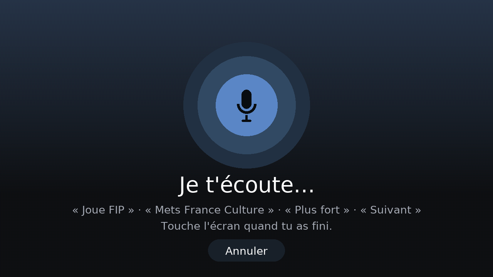

# wiimscreen

**An open-source touchscreen remote control and "now playing" display for WiiM music streamers. It runs on ESP32.**

*Version française : [LISEZMOI.md](LISEZMOI.md)*

<!-- This README uses ASD-STE100 Simplified Technical English: short sentences, active voice, one instruction per
step. Keep this style when you change it. -->

wiimscreen shows the album art, the track data and the presets of your WiiM on a color touchscreen. You can also
control the playback and the volume. The device uses the local HTTP API of the WiiM. It does not use a cloud
service or a phone app. French voice commands are optional.

The firmware is for ESP32 boards that have a touchscreen and PSRAM. The core logic does not use the hardware and has
unit tests. The screen layout changes to fit the screen size.

**Only one board is tested at this time: the [M5Stack Tab5](https://docs.m5stack.com/en/core/Tab5)** (ESP32-P4,
5", 1280×720). The downloads and the instructions in this file are for the Tab5. You can port the firmware to other
boards. Refer to [Other ESP32 boards](#other-esp32-boards).

[](LICENSE)
[](https://github.com/arthurcousin74-stack/wiimscreen/actions/workflows/firmware.yml)


> **Status: beta.**
> - The firmware compiles and the unit tests pass.
> - The screen images in this file come from the real UI code (refer to [tools/preview](tools/preview/)).
> - We test the firmware on a real Tab5 at this time. No other board is tested.
> - The screen text and the voice commands are in **French** at this time. Translations are welcome.
>
> If you find a problem, please [open an issue](../../issues). Tell us what works and what does not work.

## Features

- **Now playing**: large album art, title, artist and album. The device also shows the source (Spotify, TIDAL,
  AirPlay, Bluetooth…) and the audio quality (*16 bits · 44.1 kHz*). Touch the progress bar to go to a different
  position in the track. A "live" badge shows for radio streams.
- **Colors from the album art**: the background, the play button and the bars use the main color of the album art.
- **Favorites**: while an album or a playlist plays (for example from Qobuz), touch the heart button. The device
  keeps a copy of the WiiM play queue. The album then shows as a tile, and one touch plays it again. You do not
  need a key for the streaming service. The device keeps a maximum of 24 favorites.
- **Presets as tiles** with their images. The device gets the presets from the WiiM, or you can write your own list.
  Each page shows 6 presets. Swipe to see the next page. A frame shows the preset that plays.
- **Volume**: touch the volume bar to set the volume. You can also mute or use the − and + buttons.
- **Navigation bar** on the left side of the screen (at the top in portrait): the 🏠 button goes to the main
  screen, the ⚙ button opens the settings.
- **Ambient view**: after 60 seconds without a touch, the device shows a large album art and large text. You can
  read it from across the room. Touch the 🏠 button or the screen to go back.
- **Spectrum visualizer** (optional, experimental): in the ambient view, the microphones of the device show the
  sound spectrum. The device does the analysis itself. It does not record or send the sound.
- **Automatic WiiM discovery**: the device finds the WiiM players on your network (SSDP and `getStatusEx`). You
  select one player. If the IP address of the player changes, the device finds it again.
- **Setup from a phone**: scan the QR code on the screen, select your Wi-Fi network and save.
- **Voice commands** (optional, French, with OpenAI speech-to-text): for example *« Joue FIP »*,
  *« Mets France Culture »*, *« Plus fort »*, *« Volume 30 »*, *« Suivant »*. The device finds your presets, the
  playback commands and the radio stations of the open [Radio Browser](https://www.radio-browser.info/) directory.
- **Over-the-air updates**: install a new firmware from a web browser on your network. The device shows a 6-digit
  code that you must type.
- **Other functions**: pick up the device to turn on the screen (IMU). The screen becomes dim when you do not use
  it. The device makes a click sound when you touch a button.
- **Security**: the device keeps the SHA-256 fingerprint of the WiiM TLS certificate after the first connection.
  It compares the fingerprint before each request. Album art and online services use HTTPS with the Mozilla root
  certificates. The device does not show or log your passwords and keys.

| Ambient view + visualizer | Radio, loading, notification | Voice |
|---|---|---|
|  |  |  |
| **Presets without images (page 2 of 12)** | **WiiM discovery** | **Over-the-air update** |
|  |  |  |

## Hardware

**Players**: WiiM streamers (Mini, Pro, Pro Plus, Amp, Ultra…). Other LinkPlay players with the `httpapi.asp`
interface can possibly work. We did not test them.

**Boards**:

| Board | Status |
|---|---|
| [M5Stack Tab5](https://docs.m5stack.com/en/core/Tab5): ESP32-P4, 5" 1280×720 touchscreen, 32 MB PSRAM, Wi-Fi 2.4 GHz through an ESP32-C6, microphones, speaker | **Supported. This is the only tested board** (beta). The battery is optional. |
| Other ESP32-S3 or ESP32-P4 boards with a touchscreen and PSRAM | Not tested. A port is possible. Refer to [Other ESP32 boards](#other-esp32-boards). |
| M5Stack PaperS3 (e-ink) | An old version of the project ran on this board (refer to the git history). We do not maintain it. |

## Quick start (M5Stack Tab5)

### 1. Get the firmware

1. Go to the [latest release](../../releases).
2. Download the file `wiim-remote-tab5.bin`.

Note: you can also get the file from the latest [Actions](../../actions) run (artifact `wiim-remote-tab5`).

### 2. Flash the firmware

You need Chrome or Edge on a computer. You do not have to install software.

1. Connect the Tab5 to the computer with a USB-C **data** cable.
2. Push the power button one time to turn on the Tab5.
3. Push and hold the power button until the green LED flashes. The Tab5 is now in download mode.
4. Open <https://espressif.github.io/esptool-js/> in the browser.
5. Click **Connect**.
6. Select the port of the Tab5. Do not select COM1.
7. Set the flash address to **`0x0`**.
8. Select the file `wiim-remote-tab5.bin`.
9. Click **Program**.
10. When the browser shows that the operation is complete, reset the Tab5.

### 3. Configure the Tab5

1. Scan the QR code on the screen with your phone.
2. Select your Wi-Fi network.
3. Type the Wi-Fi password.
4. Leave the WiiM address empty. The Tab5 finds the WiiM itself.
5. Tap **Enregistrer et redémarrer** (save and restart).

### Update the firmware later

1. On the Tab5, touch the ⚙ button in the left bar.
2. Select **Mise à jour** (update). The Tab5 shows an address and a 6-digit code.
3. On a computer on the same network, open the address in a web browser.
4. Type the code and select the new `.bin` file.
5. Click **Installer** (install). The Tab5 restarts with the new firmware.

A full guide in French is in [LISEZMOI.md](LISEZMOI.md).

### Voice commands (optional)

1. Make an API key at <https://platform.openai.com>.
2. Open the setup page (touch ⚙ in the left bar, then **Configuration**).
3. Paste the key in **Commande vocale**.

Note: the device sends the sound to OpenAI only while the microphone listens. The cost was approximately
$0.003 for each minute of sound when we wrote this file. This is a few cents each month.

## How it works

```
 ESP32 board (tested: M5Stack Tab5)                            WiiM streamer
┌──────────────────────────────────────────────┐   HTTPS      ┌──────────────┐
│ main.cpp      loop: touch, drawing, menus,   │  ─────────▶  │ httpapi.asp  │
│               ambient view, voice, OTA       │  pinned TLS  │ getPlayer-   │
│ wiim_worker   background task: polling,      │  keep-alive  │ Status, get- │
│               command queue                  │              │ MetaInfo…    │
│ wiim_client   TLS client, WiiM commands      │              │              │
│ discovery     SSDP + getStatusEx             │ ◀─ SSDP ───  └──────────────┘
│ art           background download of covers  │ ──▶ CDNs (album art, preset logos)
│ ui            off-screen canvas (PSRAM) →    │
│               MIPI-DSI panel, accent color   │
│ voice_service OpenAI STT, Radio Browser      │ ──▶ api.openai.com, radio-browser.info
│ ota / portal  web pages for update & setup   │
│ lib/core      pure C++ logic, unit-tested    │
└──────────────────────────────────────────────┘
```

- **`lib/core/`** contains all the logic that does not use the hardware: WiiM response parsing, layout, accent
  color, FFT spectrum, motion detection, voice-intent parsing and firmware-image filtering. You can test it on a PC
  with `pio test -e native`.
- **`src/`** contains the device firmware (Arduino-ESP32 3.x on ESP-IDF 5 through pioarduino, M5Unified and M5GFX).
- **`tools/preview/`** compiles the real `src/ui.cpp` for a PC (M5GFX and SDL2). It makes a PNG image of each
  screen. Thus you can design the UI without the device.
- **[docs/WIIM_API_NOTES.md](docs/WIIM_API_NOTES.md)** contains practical notes about the WiiM/LinkPlay HTTP API.
  These notes add data that the official PDF does not make clear.

## Build from source

```bash
pip install platformio "click<8.2"   # the esptool of the platform needs click < 8.2
pio test -e native                   # unit tests on the PC
pio run -e tab5                      # firmware
pio run -e tab5 -t upload            # flash through USB
```

To see the UI on a PC, install SDL2 first (Linux: `sudo apt install libsdl2-dev`; macOS: `brew install sdl2`).
Then do these commands:

```bash
pio run -e preview
SDL_VIDEODRIVER=dummy .pio/build/preview/program images/ out/   # images/: cover.jpg, preset1..6.jpg|png
python tools/preview/topng.py out/*.ppm
```

## Other ESP32 boards

We tested only the Tab5. Other ESP32 boards need a small quantity of new code. They do not need a full rewrite.

- **Code that you can use as is**: `lib/core` (plain C++17, no Arduino headers), `wiim_worker`, `wiim_client`,
  `discovery`, `art`, `voice_service`, `portal`, `ota` and `settings`. These files use the Arduino-ESP32 3.x Wi-Fi,
  TLS, WebServer and NVS functions.
- **Screen and input**: `ui.cpp` uses M5GFX to draw. `main.cpp` uses M5Unified to read the touchscreen, the IMU, the
  microphone and the speaker. Thus the boards that M5Unified and M5GFX support (for example the M5Stack CoreS3) are
  the easiest to port. For other boards, you must write a display configuration (LovyanGFX or M5GFX `LGFX` class).
- **Layout**: `computeLayout()` fits all screen sizes. Its tests check 1280×720, 720×1280 and 960×540 for overlaps
  and for the size of the touch areas. Add the size of your screen to these tests.
- **Parts that are specific to the Tab5**:
  - The SDIO pins to the ESP32-C6 Wi-Fi chip (`WiFi.setPins(...)` in `main.cpp`). Remove this line on boards with
    built-in Wi-Fi.
  - The microphone and the speaker use the same I2S bus (`sound.cpp`).
  - The `[env:tab5]` board settings in `platformio.ini`.
- **Memory**: the off-screen canvas uses 16 bits for each pixel and covers the full screen. It needs approximately
  1.8 MB at 1280×720 and 300 KB at 480×320. Thus the board must have PSRAM. TLS and album art decoding also use PSRAM.
  The microphone, the IMU and the speaker are optional.

To add a board:

1. Add an `[env:<board>]` section to `platformio.ini`.
2. Put the differences between boards in small `#if` blocks or in a board header file.
3. In your pull request, tell us what you tested on the real hardware.

## Use the project as a base

- **Only the WiiM integration**: `wiim_client.*`, `discovery.*`, `wiim_worker.*` and `lib/core` are a small WiiM
  library for ESP32. They give pinned HTTPS, keep-alive connections, discovery, background polling and a command
  queue.
- **A different player with an HTTP API**: replace `wiim_client.*` and the parsers in `lib/core/core.cpp`.
- **A different screen**: refer to [Other ESP32 boards](#other-esp32-boards).

[AGENTS.md](AGENTS.md) gives the architecture, the conventions and the known problems. It is for human developers and
for AI coding agents.

## Security and privacy

All the data stays on your local network, except for the album art, the voice commands and the radio search.
For more data and to report a problem, refer to [SECURITY.md](SECURITY.md).

- The TLS connection to the WiiM uses a pinned certificate.
- All other HTTPS connections use the Mozilla root certificates.
- The setup mode and the update mode start only after an action on the device. They use a random password or a
  6-digit code.
- The microphone operates only in the ambient view (visualizer) or when you give a voice command.

## Contributing

We welcome these contributions:

- Bug reports. Give your WiiM model, your board and the firmware version. To see the version, touch ⚙ in the left
  bar. The version shows at the bottom of the *Réglages* menu.
- Test reports from real hardware.
- Ports to other ESP32 boards.
- Translations.
- UI improvements.

Refer to [CONTRIBUTING.md](CONTRIBUTING.md).

## License

[MIT](LICENSE) © wiimscreen contributors. Third-party components: [THIRD_PARTY_NOTICES.md](THIRD_PARTY_NOTICES.md).
This project has no connection with WiiM / Linkplay, M5Stack or Espressif.
