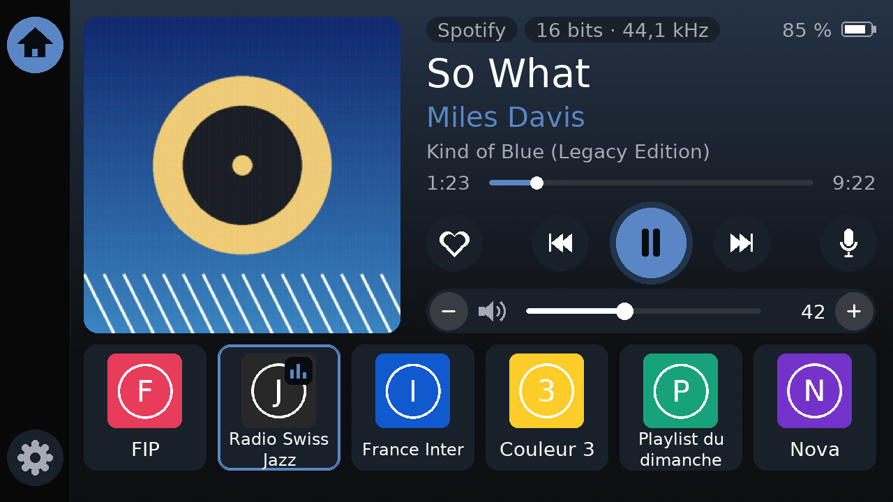
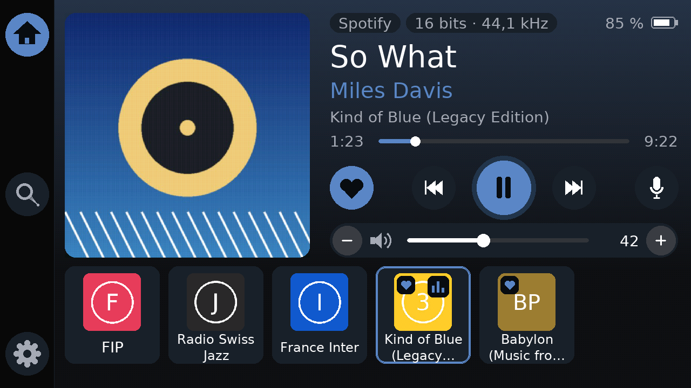
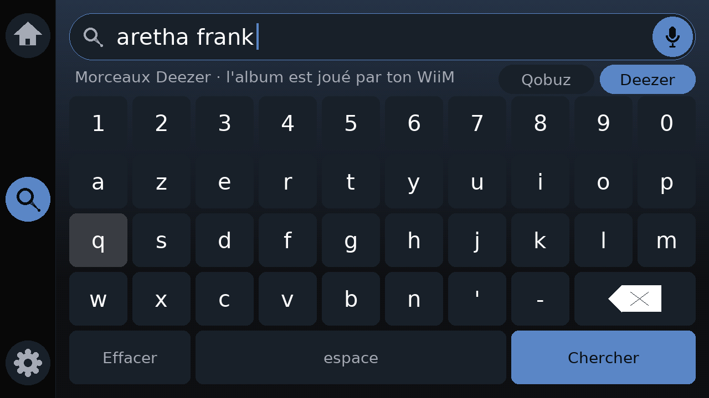
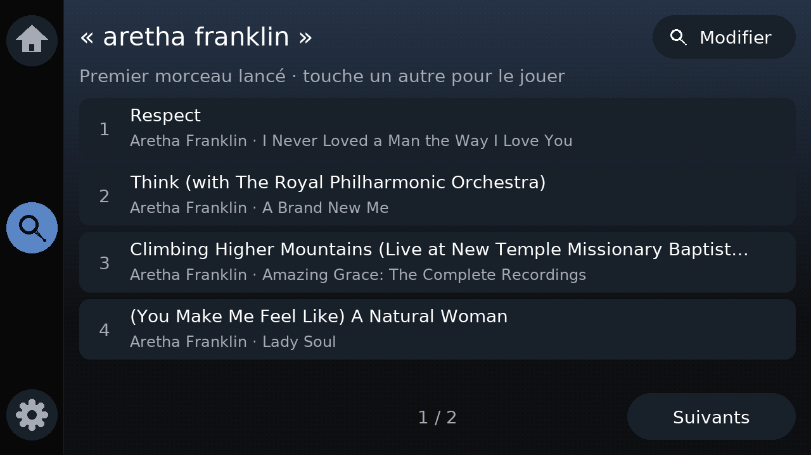
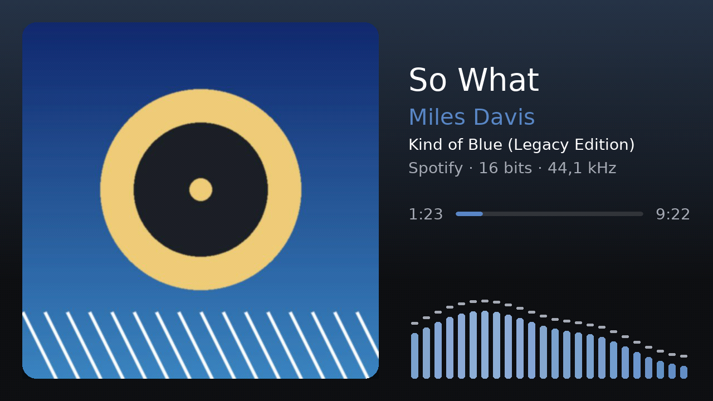
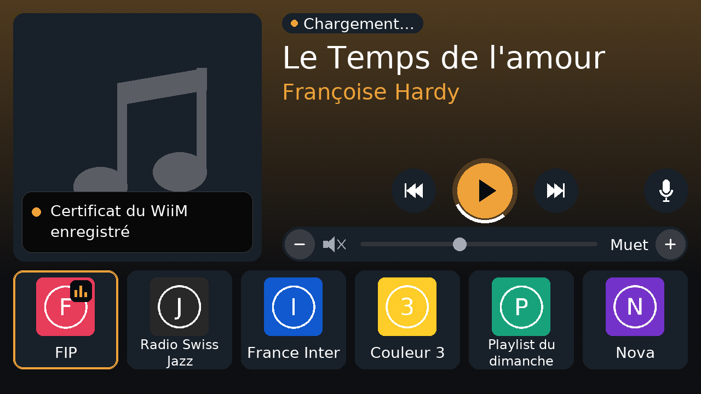
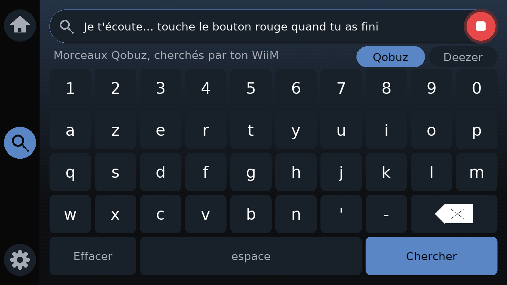
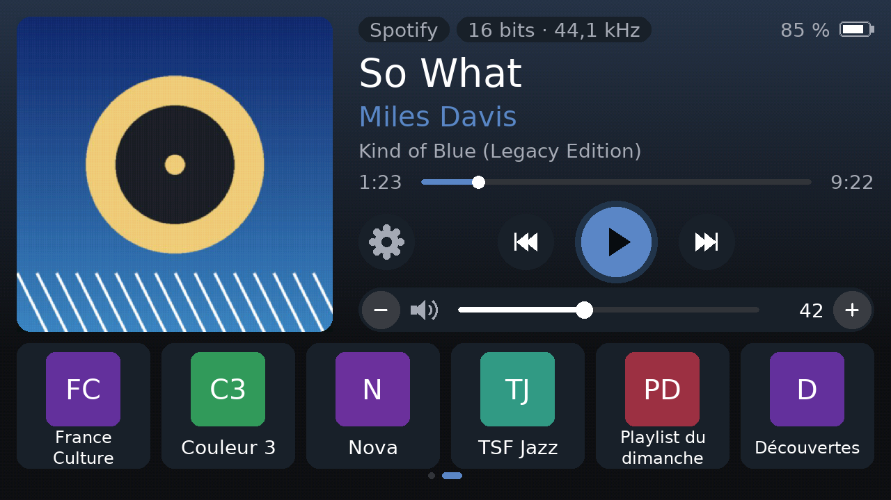
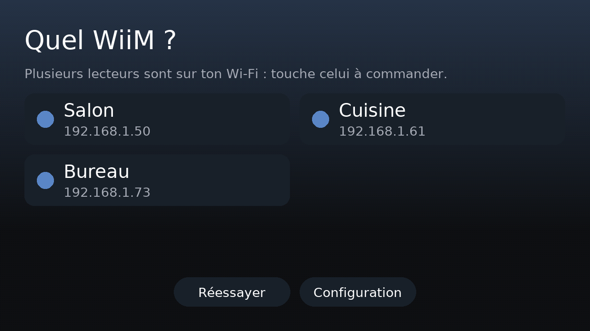
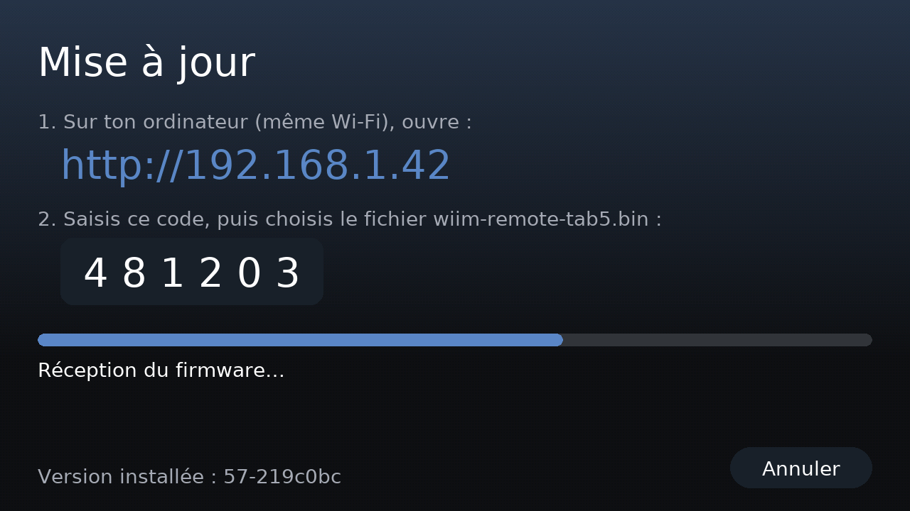

# wiimscreen

**An open-source touchscreen remote control and "now playing" display for WiiM music streamers. It runs on ESP32.**

*Version française : [LISEZMOI.md](LISEZMOI.md)*

<!-- This README uses ASD-STE100 Simplified Technical English: short sentences, active voice, one instruction per
step. Keep this style when you change it. -->

wiimscreen shows the album art, the track data and the presets of your WiiM on a color touchscreen. You can also
control the playback and the volume, keep your own favorites, and search Qobuz and Deezer. The device uses the local
network interfaces of the WiiM (HTTP API and UPnP). It does not use a cloud service or a phone app. It does not need
a key or a password for a streaming service: the WiiM gives its own Qobuz access to the device, and the Deezer search
uses the public Deezer catalog. Voice search (OpenAI speech-to-text) is optional.

The firmware is for ESP32 boards that have a touchscreen and PSRAM. The core logic does not use the hardware and has
unit tests. The screen layout changes to fit the screen size.

**Only one board is tested at this time: the [M5Stack Tab5](https://docs.m5stack.com/en/core/Tab5)** (ESP32-P4,
5", 1280×720). The downloads and the instructions in this file are for the Tab5. You can port the firmware to other
boards. Refer to [Other ESP32 boards](#other-esp32-boards).

[](LICENSE)
[](https://github.com/arthurcousin74-stack/wiimscreen/actions/workflows/firmware.yml)




> **Status: beta.**
> - The firmware compiles and the unit tests pass.
> - The screen images in this file come from the real UI code (refer to [tools/preview](tools/preview/)).
> - These functions operate on a real Tab5 with a real WiiM: touch, Wi-Fi, playback status and control, the
>   navigation bar, the WiiM queue check, the Qobuz search, and the load of a Deezer album from its ID.
> - These functions are not yet confirmed on real hardware: the replay of favorites, the Deezer search screen, the
>   return of the previous music after a Qobuz search, the voice search, the visualizer and the selection between
>   several WiiM players.
> - No other board is tested.
> - The screen text and the voice search are in **French** at this time. Translations are welcome.
>
> If you find a problem, please [open an issue](../../issues). Tell us what works and what does not work.

## Features

- **Now playing**: large album art, title, artist and album. The device also shows the source (Spotify, TIDAL,
  AirPlay, Bluetooth…) and the audio quality (*16 bits · 44.1 kHz*). Touch the progress bar to go to a different
  position in the track. A "live" badge shows for radio streams.
- **Colors from the album art**: the background, the play button and the bars use the main color of the album art.
- **Qobuz favorites**: the favorite albums of your Qobuz account show as tiles with their album art. One touch plays
  the album. The **Favoris Qobuz** tile plays your favorite tracks.
- **Deezer favorites** (experimental): if your WiiM gives a Deezer access, the favorite albums of your Deezer account
  also show as tiles. One touch plays the album.
- **Favorites**: while an album or a playlist plays (for example from Qobuz), touch the heart button at the left
  of the playback buttons. The device keeps a copy of the WiiM play queue. The album then shows as a tile with its
  album art, and one touch plays it again. Touch the heart again to remove the album. You do not need a key for
  the streaming service. The device keeps a maximum of 24 favorites.
- **Qobuz search** without a key: touch the magnifying glass in the left bar and type an artist or a track on the
  on-screen keyboard. The device searches Qobuz with the access that your WiiM gives. It shows the results (title,
  artist, album). The music does not change until you touch a result. Then the WiiM plays the album of this track,
  from this track. Before the first search, play one Qobuz album from the WiiM Home app. Refer to
  [Search Qobuz](#search-qobuz).
- **Deezer search**: on the search screen, select **Deezer**. The device searches the public Deezer catalog (no
  key). When you touch a result, the WiiM plays the album of this track, from this track. Before the first
  search, play one Deezer album from the WiiM Home app.
- **Presets as tiles** with their images. The device gets the presets from the WiiM, or you can write your own list.
  Each page shows 6 presets. Swipe to see the next page. A frame shows the preset that plays.
- **Volume**: touch the volume bar to set the volume. You can also mute or use the − and + buttons.
- **Navigation bar** on the left side of the screen (at the top in portrait): the 🏠 button goes to the main
  screen, the magnifying glass opens the search (Qobuz or Deezer), the ⚙ button opens the settings.
- **Feedback**: a ring turns around a button until the WiiM does the command (next track, play, pause, preset,
  favorite, search result). The keyboard shows each key press at once.
- **Ambient view**: after 60 seconds without a touch, the device shows a large album art and large text. You can
  read it from across the room. Touch the 🏠 button or the screen to go back.
- **Spectrum visualizer** (optional, experimental): in the ambient view, the microphones of the device show the
  sound spectrum. The device does the analysis itself. It does not record or send the sound.
- **Automatic WiiM discovery**: the device finds the WiiM players on your network (SSDP and `getStatusEx`). You
  select one player. If the IP address of the player changes, the device finds it again.
- **Setup from a phone**: scan the QR code on the screen, select your Wi-Fi network and save.
- **Voice search** (optional, with OpenAI speech-to-text): on the search screen, touch the microphone in the
  search field and say an artist, a track or an album. Touch the red button when you stop. The device writes what
  you said in the field and starts the search.
- **Over-the-air updates**: install a new firmware from a web browser on your network. The device shows a 6-digit
  code that you must type.
- **Diagnostics**: the *Journal* (⚙ › *Journal*) shows the last events: touches, commands and the WiiM answers.
  The *File du WiiM* button reads the play queues of the WiiM and the actions of its queue service. The *Essais*
  button tests the Qobuz favorites and the Deezer albums. Use these data in bug reports.
- **Sleep**: ⚙ › *Mise en veille* turns off the Tab5 at once. In the setup page, you can also set an automatic
  sleep (after 30 min, 1 h or 2 h without a touch and without music; the default is "never"). Push the power button
  to turn the Tab5 on again. Note: a touch on the screen cannot wake the Tab5 from this sleep.
- **Other functions**: pick up the device to turn on the screen (IMU). The screen becomes dim when you do not use
  it. The device makes a click sound when you touch a button.
- **Security**: the device keeps the SHA-256 fingerprint of the WiiM TLS certificate after the first connection.
  It compares the fingerprint before each request. Album art and online services use HTTPS with the Mozilla root
  certificates. The device does not show or log your passwords and keys.

| Favorites (tiles with a heart) | Search (Qobuz or Deezer) | Search results |
|---|---|---|
|  |  |  |
| **Ambient view + visualizer** | **Radio, loading, notification** | **Voice search (listening)** |
|  |  |  |
| **Presets without images (page 2 of 12)** | **WiiM discovery** | **Over-the-air update** |
|  |  |  |

## Hardware

**Players**: WiiM streamers (Mini, Pro, Pro Plus, Amp, Ultra…). Other LinkPlay players with the `httpapi.asp`
interface can possibly work. We did not test them.

**Boards**:

| Board | Status |
|---|---|
| [M5Stack Tab5](https://docs.m5stack.com/en/core/Tab5): ESP32-P4, 5" 1280×720 touchscreen, 32 MB PSRAM, Wi-Fi 2.4 GHz through an ESP32-C6, microphones, speaker | **Supported. This is the only tested board** (beta). The battery is optional. |
| Other ESP32-S3 or ESP32-P4 boards with a touchscreen and PSRAM | Not tested. A port is possible. Refer to [Other ESP32 boards](#other-esp32-boards). |
| M5Stack PaperS3 (e-ink) | An old version of the project ran on this board (refer to the git history). We do not maintain it. |

## Quick start (M5Stack Tab5)

### 1. Get the firmware

1. Go to the [latest release](../../releases).
2. Download the file `wiim-remote-tab5.bin`.

Note: you can also get the file from the latest [Actions](../../actions) run (artifact `wiim-remote-tab5`).

### 2. Flash the firmware

You need Chrome or Edge on a computer. You do not have to install software.

1. Connect the Tab5 to the computer with a USB-C **data** cable.
2. Push the power button one time to turn on the Tab5.
3. Push and hold the power button until the green LED flashes. The Tab5 is now in download mode.
4. Open <https://espressif.github.io/esptool-js/> in the browser.
5. Click **Connect**.
6. Select the port of the Tab5. Do not select COM1.
7. Set the flash address to **`0x0`**.
8. Select the file `wiim-remote-tab5.bin`.
9. Click **Program**.
10. When the browser shows that the operation is complete, reset the Tab5.

### 3. Configure the Tab5

1. Scan the QR code on the screen with your phone.
2. Select your Wi-Fi network.
3. Type the Wi-Fi password.
4. Leave the WiiM address empty. The Tab5 finds the WiiM itself.
5. Tap **Enregistrer et redémarrer** (save and restart).

### Update the firmware later

1. On the Tab5, touch the ⚙ button in the left bar.
2. Select **Mise à jour** (update). The Tab5 shows an address and a 6-digit code.
3. On a computer on the same network, open the address in a web browser.
4. Type the code and select the new `.bin` file.
5. Click **Installer** (install). The Tab5 restarts with the new firmware.

Note: an update keeps your settings (Wi-Fi, WiiM, OpenAI key, options) and your favorites. A complete USB flash at
address `0x0` erases the settings area, but the Tab5 also keeps a copy of the settings with the favorites. At the
next start, it puts the settings back from this copy. To erase everything, use "Erase flash" in esptool-js.

A full guide in French is in [LISEZMOI.md](LISEZMOI.md).

### Search Qobuz

The WiiM must have your Qobuz account (WiiM Home app › Qobuz). The Tab5 does not need a Qobuz key or password.

1. In the WiiM Home app, play one Qobuz album. Do this one time only: the Tab5 copies the Qobuz settings of the
   WiiM (account name, quality) from this play queue.
2. On the Tab5, touch the magnifying glass in the left bar.
3. Make sure that **Qobuz** is selected (below the search field).
4. Type an artist or a track, then touch **Chercher** (search).
5. Wait 1 or 2 seconds. The Tab5 shows the results. The music does not change.
6. Touch a result. The WiiM plays the album of this track, from this track.

Note: if the WiiM does not give its Qobuz access, the Tab5 uses an older method: the WiiM does the search in a play
queue. Then the WiiM starts a result, so the Tab5 mutes the WiiM and puts back the music that played before.

Note: the search finds tracks. To keep an album, play it and touch the heart button.

### Search Deezer

The WiiM must have your Deezer account (WiiM Home app › Deezer). The Tab5 does not need a Deezer key or password.

1. In the WiiM Home app, play one Deezer album. Then, on the Tab5, touch ⚙ › *Journal* › **File du WiiM**. Do this
   one time only: the Tab5 copies the Deezer settings of the WiiM from this play queue.
2. On the Tab5, touch the magnifying glass in the left bar, then select **Deezer**.
3. Type an artist or a track, then touch **Chercher**. The Tab5 searches the public Deezer catalog.
4. Touch a result. The WiiM loads the album of this track and plays it from this track (wait some seconds).

### Favorites from Qobuz and Deezer

The WiiM must have your accounts (WiiM Home app). The Tab5 gets the favorites with the access that your WiiM gives.

1. Play one Qobuz album and one Deezer album from the WiiM Home app. Do this one time only.
2. For Deezer, on the Tab5, touch ⚙ › *Journal* › **File du WiiM** while the Deezer album plays.
3. Go back to the main screen (🏠). Swipe the tiles to see the favorite albums. The Tab5 updates the list when it
   updates the presets.
4. Touch an album. The WiiM plays it.

Note: the Deezer favorites are experimental. If they do not show, look at the Journal: the lines that start with
"Deezer :" tell which step failed.

### Voice search (optional)

1. Make an API key at <https://platform.openai.com>.
2. Open the setup page (touch ⚙ in the left bar, then **Configuration**). The Tab5 restarts in setup mode.
3. Paste the key in **Commande vocale**, then save.
4. On the search screen, touch the microphone in the search field. Wait for the beep. The music becomes quieter.
5. Say an artist, a track or an album.
6. Touch the red button. The Tab5 writes the text and starts the search (Qobuz or Deezer, as selected).

Note: the Tab5 listens for a maximum of 8 seconds. Touch 🏠 or ⚙ to cancel.

Note: the device sends the sound to OpenAI only while the microphone listens. The cost was approximately
$0.003 for each minute of sound when we wrote this file. This is a few cents each month.

## How it works

```
 ESP32 board (tested: M5Stack Tab5)                            WiiM streamer
┌──────────────────────────────────────────────┐   HTTPS      ┌──────────────┐
│ main.cpp      loop: touch, drawing, menus,   │  ─────────▶  │ httpapi.asp  │
│               ambient view, voice, OTA       │  pinned TLS  │ getPlayer-   │
│ wiim_worker   background task: polling,      │  keep-alive  │ Status, get- │
│               commands, queues, search       │              │ MetaInfo…    │
│ wiim_client   TLS client, WiiM commands      │  UPnP SOAP   │ PlayQueue    │
│ favorites     queue copies (LittleFS)        │  port 49152  │ (queues)     │
│ discovery     SSDP + getStatusEx             │ ◀─ SSDP ───  └──────┬───────┘
│ wiim_worker   Qobuz search and favorites     │ ──▶ qobuz.com (access from the WiiM)
│               Deezer favorites               │ ──▶ api.deezer.com (access from the WiiM)
│                                              │                     │ WiiM's own
│                                              │                     ▼ access
│                                              │          qobuz.com, airable.io (Deezer)
│ art           background download of covers  │ ──▶ CDNs (album art, preset logos)
│ ui            off-screen canvas (PSRAM) →    │
│               MIPI-DSI panel, accent color   │
│ voice_service OpenAI speech-to-text          │ ──▶ api.openai.com
│ wiim_worker   Deezer public search           │ ──▶ api.deezer.com
│ ota / portal  web pages for update & setup   │
│ lib/core      pure C++ logic, unit-tested    │
└──────────────────────────────────────────────┘
```

- **`lib/core/`** contains all the logic that does not use the hardware: WiiM response parsing, UPnP/XML parsing
  of the WiiM play queues, Deezer search parsing, layout, on-screen keyboard, accent color, FFT spectrum, motion
  detection, voice parsing and firmware-image filtering. You can test it on a PC
  with `pio test -e native`.
- **`src/`** contains the device firmware (Arduino-ESP32 3.x on ESP-IDF 5 through pioarduino, M5Unified and M5GFX).
- **`tools/preview/`** compiles the real `src/ui.cpp` for a PC (M5GFX and SDL2). It makes a PNG image of each
  screen. Thus you can design the UI without the device.
- **[docs/WIIM_API_NOTES.md](docs/WIIM_API_NOTES.md)** contains practical notes about the WiiM/LinkPlay HTTP API
  and about the UPnP `PlayQueue` service, which WiiM does not document. These notes add data that the official
  PDF does not make clear. They tell what we verified on a real WiiM.

### How the Qobuz search operates

The WiiM has an UPnP service, `PlayQueue`, that WiiM does not document. The WiiM Home app uses it to send a play
queue to the WiiM. A Qobuz queue contains an address of the Qobuz API (`SearchUrl`). The WiiM reads this address
with its own Qobuz access and loads the tracks. The same service gives the Qobuz access of the WiiM
(`GetUserInfo`).

1. The Tab5 reads a real Qobuz queue from the WiiM (`BrowseQueue`) and keeps it as a model.
2. The Tab5 gets the Qobuz access of the WiiM (`GetUserInfo`): an application ID and a token. It keeps them in
   memory only. It does not show, log or save the token.
3. For a search, the Tab5 sends the search to Qobuz with this access, and shows the tracks. The music does not
   change.
4. When you touch a track, the Tab5 copies the model, sets `SearchUrl` to the album of this track and sends this
   queue to the WiiM (`CreateQueue`). The WiiM loads the album.
5. The Tab5 finds the track in the queue and starts the queue at this track (`PlayQueueWithIndex`).

The Tab5 never has your Qobuz password. The favorite albums come from the same access
(`favorite/getUserFavorites`).

For Deezer, the Tab5 asks the WiiM for a Deezer access (`GetUserInfo`). If it gets one, it reads the favorite albums
from the Deezer API (`user/me/albums`). An album plays through the airable gateway of the WiiM, as for the search.

### How the Deezer search operates

The WiiM plays Deezer through a gateway (airable). A Deezer queue contains an address of this gateway with the ID
of a Deezer album.

1. The Tab5 searches the public Deezer catalog (`api.deezer.com/search`, no key). It shows the tracks.
2. When you touch a track, the Tab5 sends a queue with the address of the album of this track (`CreateQueue`).
3. The WiiM loads the tracks of the album. The Tab5 finds the position of the track and starts the queue there.

## Build from source

```bash
pip install platformio "click<8.2"   # the esptool of the platform needs click < 8.2
pio test -e native                   # unit tests on the PC
pio run -e tab5                      # firmware
pio run -e tab5 -t upload            # flash through USB
```

To see the UI on a PC, install SDL2 first (Linux: `sudo apt install libsdl2-dev`; macOS: `brew install sdl2`).
Then do these commands:

```bash
pio run -e preview
SDL_VIDEODRIVER=dummy .pio/build/preview/program images/ out/   # images/: cover.jpg, preset1..6.jpg|png
python tools/preview/topng.py out/*.ppm
```

## Other ESP32 boards

We tested only the Tab5. Other ESP32 boards need a small quantity of new code. They do not need a full rewrite.

- **Code that you can use as is**: `lib/core` (plain C++17, no Arduino headers), `wiim_worker`, `wiim_client`,
  `discovery`, `art`, `voice_service`, `portal`, `ota` and `settings`. These files use the Arduino-ESP32 3.x Wi-Fi,
  TLS, WebServer and NVS functions.
- **Screen and input**: `ui.cpp` uses M5GFX to draw. `main.cpp` uses M5Unified to read the touchscreen, the IMU, the
  microphone and the speaker. Thus the boards that M5Unified and M5GFX support (for example the M5Stack CoreS3) are
  the easiest to port. For other boards, you must write a display configuration (LovyanGFX or M5GFX `LGFX` class).
- **Layout**: `computeLayout()` fits all screen sizes. Its tests check 1280×720, 720×1280 and 960×540 for overlaps
  and for the size of the touch areas. Add the size of your screen to these tests.
- **Parts that are specific to the Tab5**:
  - The SDIO pins to the ESP32-C6 Wi-Fi chip (`WiFi.setPins(...)` in `main.cpp`). Remove this line on boards with
    built-in Wi-Fi.
  - The microphone and the speaker use the same I2S bus (`sound.cpp`).
  - The `[env:tab5]` board settings in `platformio.ini`.
- **Memory**: the off-screen canvas uses 16 bits for each pixel and covers the full screen. It needs approximately
  1.8 MB at 1280×720 and 300 KB at 480×320. Thus the board must have PSRAM. TLS and album art decoding also use PSRAM.
  The microphone, the IMU and the speaker are optional.

To add a board:

1. Add an `[env:<board>]` section to `platformio.ini`.
2. Put the differences between boards in small `#if` blocks or in a board header file.
3. In your pull request, tell us what you tested on the real hardware.

## Use the project as a base

- **Only the WiiM integration**: `wiim_client.*`, `discovery.*`, `wiim_worker.*` and `lib/core` are a small WiiM
  library for ESP32. They give pinned HTTPS, keep-alive connections, discovery, background polling, a command
  queue, and the read and write of WiiM play queues (`lib/core/src/upnp.*`).
- **A different player with an HTTP API**: replace `wiim_client.*` and the parsers in `lib/core/core.cpp`.
- **A different screen**: refer to [Other ESP32 boards](#other-esp32-boards).

[AGENTS.md](AGENTS.md) gives the architecture, the conventions and the known problems. It is for human developers and
for AI coding agents.

## Security and privacy

All the data stays on your local network, except for the album art, the voice search, the Deezer search and the
Qobuz requests (search and favorites). For Qobuz, the Tab5 uses the access that your WiiM gives on your local
network. It keeps this access in memory only.
For more data and to report a problem, refer to [SECURITY.md](SECURITY.md).

- The TLS connection to the WiiM uses a pinned certificate.
- The UPnP requests to the WiiM (play queues, search) use plain HTTP on your local network, as the WiiM Home app
  does. The Journal and the serial log hide the Qobuz account name and the tokens.
- All other HTTPS connections use the Mozilla root certificates.
- The setup mode and the update mode start only after an action on the device. They use a random password or a
  6-digit code.
- The microphone operates only in the ambient view (visualizer) or while you dictate a search.

## Contributing

We welcome these contributions:

- Bug reports. Give your WiiM model, your board and the firmware version. To see the version, touch ⚙ in the left
  bar. The version shows at the bottom of the *Réglages* menu.
- Test reports from real hardware.
- Ports to other ESP32 boards.
- Translations.
- UI improvements.

Refer to [CONTRIBUTING.md](CONTRIBUTING.md).

## License

[MIT](LICENSE) © wiimscreen contributors. Third-party components: [THIRD_PARTY_NOTICES.md](THIRD_PARTY_NOTICES.md).
This project has no connection with WiiM / Linkplay, M5Stack or Espressif.
